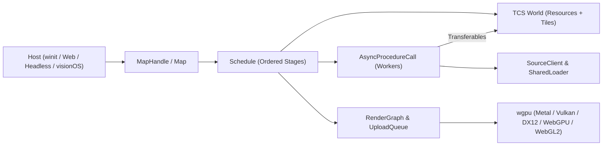

# Architecture

`maplibre` is structured as a modular, data-oriented rendering engine tailored specifically to slippy-map tile pyramids, 3D terrain, planetary globes, and stereo XR views. Every major subsystem lives inside [`maplibre/src/`](../../../../maplibre/src) with zero `unsafe` code in the renderer (`#![forbid(unsafe_code)]` in `maplibre::render`) and strict fallible error propagation across initialization and frame execution.



## 1. Tile Component System (`maplibre::tcs`)

Early prototypes experimented with general-purpose Entity-Component-System (ECS) frameworks, which added archetype fragmentation and indirection without matching the natural key of a map engine: **hierarchical tile coordinates** (`WorldTileCoords`).

`maplibre::tcs` replaces generic ECS storage with a domain-specific **Tile Component System (TCS)**:

- **`World`** pairs two stores under one ownership root:
  - **`Resources`** — singleton typed state (`ViewState`, `Style`, `WgpuTileViewPattern`, `TerrainResources`, `FrameTimings`, lighting, global state) keyed by `TypeId`.
  - **`Tiles`** — per-tile typed `TileComponent` attachments (`VectorLayersDataComponent`, `RasterLayersDataComponent`, `DemTileComponent`, symbol/SDF layout data, missing-layer markers) indexed by `WorldTileCoords` inside a spatial quadtree/pyramid (`tcs::pyramid`).
- **Borrow-checked queries**: `GlobalQueryState` and `EphemeralQueryState` track shared and mutable `TypeId` borrows dynamically when a system runs, preventing aliasing without unsafe code.
- **Typed errors**: every system implements `System` (`fn run(&mut self, context: &mut MapContext) -> Result<(), SystemError>`), returning structured failures rather than panicking.

## 2. `Schedule`, Stages, and Fallible `Plugin`s

Frame execution is driven by [`Schedule`](../../../../maplibre/src/schedule.rs), an ordered list of labeled [`Stage`](../../../../maplibre/src/schedule.rs)s operating on [`MapContext`](../../../../maplibre/src/context.rs) (`World`, `Style`, `ViewState`, `Renderer`).

### Default Frame Stages (`RenderStageLabel`)

`RenderPlugin` installs seven deterministic stages in `Schedule`:

1. **`Input`** — applies host viewport/cursor input, drains `MapCommands` from `MapHandle`s, and advances camera flights (`fly_to` / `ease_to`) so every downstream system observes the resolved `ViewState` (or stereo `XrFrame` / multi-view slot).
2. **`Request`** — computes the visible tile covering (including globe horizon culling, terrain elevation bounds, XR frustum union, and flight `PrefetchView`), dispatches missing vector/raster/DEM fetches through `AsyncProcedureCall`, and ingests completed worker results into `World.tiles`.
3. **`Prepare`** — creates or resizes GPU attachments, compiles demand-driven shaders/pipelines (`PipelineCache`), prepares glyph/sprite atlases, and writes per-frame view/globe/lighting uniforms.
4. **`Queue`** — uploads newly arrived vertex/index/instance/texture payloads through `UploadQueue` and populates [`RenderPhase`](../../../../maplibre/src/render/render_phase.rs) queues (`TileMaskItem`, `LayerItem`, `TranslucentItem`, `DrapePhase`).
5. **`PhaseSort`** — sorts phase items into deterministic MapLibre layer and depth order and harvests completed GPU timestamp queries (`gpu_timer`).
6. **`Render`** — executes [`RenderGraph`](../../../../maplibre/src/render/graph.rs) passes, submits command buffers, and presents swapchain or eye targets.
7. **`Cleanup`** — marked with `Schedule::run_after_failure` so per-frame phase queues are cleared and out-of-budget tiles are evicted even if an earlier stage returned a `StageError`.

### Fallible Plugin Composition (`Plugin<E>`)

Capabilities are modularized behind [`Plugin<E>`](../../../../maplibre/src/plugin.rs):

```rust,ignore
pub trait Plugin<E: Environment> {
    fn build(
        &self,
        schedule: &mut Schedule,
        kernel: Rc<Kernel<E>>,
        world: &mut World,
        renderer: &mut Renderer,
    ) -> Result<(), PluginError>;
}
```

Hosts (`maplibre_winit::default_plugins`, `web`, `HeadlessMap`) inspect the `Style` and install only the plugins needed (`RenderPlugin`, `BackgroundPlugin`, `VectorPlugin`, `SdfPlugin`, `HeatmapPlugin`, `RasterPlugin`, `HillshadePlugin`, `TerrainPlugin`, `NavigationHudPlugin`, `DebugPlugin`). Missing prerequisite stages, render-graph edges, or GPU allocation failures surface cleanly as `PluginError`.

## 3. GPU Architecture: `RenderGraph`, `BufferPool`, and `UploadQueue`

- **`RenderGraph`** orders render passes explicitly by slot dependencies:
  - **`DrapePassNode`** *(when 3D terrain is active)* renders drapeable fill, line, raster, hillshade, and color-relief layers into pooled per-tile offscreen textures (`DrapePhase`).
  - **`MainPassNode`** renders sky/starfield/atmosphere, terrain meshes or stencil-masked 2D/globe tiles, 3D fill-extrusions, circles, heatmaps, and crisp screen-space SDF symbols/labels.
  - **`DepthCopyNode` & `TranslucentPassNode`** copy resolved depth when needed and composite order-dependent translucent overlays and custom `PassHooks`.
- **`BufferPool`** sub-allocates tile vertex, index, and feature-paint slices inside large backing `wgpu::Buffer` arenas, avoiding per-tile buffer allocation churn and minimizing bind-group switches.
- **Counted `UploadQueue`**: `Renderer` wraps `wgpu::Queue` inside [`UploadQueue`](../../../../maplibre/src/render/upload_queue.rs), which atomically counts every byte written via `write_buffer`, `write_texture`, `create_buffer_init`, and `create_texture_with_data`. Direct calls to uncounted `wgpu::Queue` upload methods are denied workspace-wide via `clippy.toml`, ensuring frame traces and upload budgets remain exact.
- **In-place GPU style & state refresh**: style mutations (`set_paint_property`, `set_layout_property`, `set_filter`, `set_feature_state`, `set_global_state`) classify what changed (`style::mutation`). Data-driven paint and feature-state updates re-evaluate only the affected per-feature paint attributes and rewrite their `BufferPool` ranges via `UploadQueue`—without re-fetching or re-tessellating tile geometry.

## 4. Source I/O, `ResourceLoader`, and `AsyncProcedureCall` (`APC`)

`Kernel<E>` decouples the engine from the host OS or browser through the [`Environment`](../../../../maplibre/src/environment.rs) trait:

- **`ResourceLoader` & `SourceClient`** (`maplibre::io`): deduplicates in-flight HTTP, `pmtiles://`, `asset://`, and inline data requests across the map thread and all worker threads (`SharedLoader`), applying bounded concurrency (`tile_backpressure`) and exponential retry (`tile_retry`).
- **`AsyncProcedureCall` (`APC`)**: offloads CPU-heavy MVT/MLT decoding, GeoJSON clustering, expression pre-evaluation, Lyon polygon/line tessellation, glyph SDF rasterization, and `raster-dem` decoding off the render thread:
  - **Native (`SchedulerAsyncProcedureCall`)**: schedules tasks onto a multi-threaded Tokio pool and passes decoded Rust structs (`DefaultVectorTransferables`, `DefaultDemTransferables`) back with zero serialization overhead.
  - **Web (`wasm32`)**: dispatches jobs to dedicated Web Workers, serializing geometry into zero-copy FlatBuffers (`FlatBufferTransferable`) transferred via `ArrayBuffer` ownership transfer (or shared linear memory on multithreaded Wasm builds).

## 5. `HeadlessMap`, Multi-View, 3D Terrain, Atmosphere & Stereo XR

- **`HeadlessMap` & Multi-View** (`maplibre::headless`): drives deterministic offscreen rendering, shares immutable decoded tiles, sprites, glyphs, and compiled GPU pipelines across independent map worlds via `SharedMapAssets`, and renders multiple synchronized camera slots (`MultiViewFrame`, `ViewSlotId`) in a single tick.
- **3D Terrain (`maplibre::terrain`)**: decodes Mapbox and Terrarium `raster-dem` tiles into `GpuDemPool`, stitches level-of-detail seams with `backfill_neighbours` and configurable `TerrainSkirts`, closes polar caps on globes via `PolarPoleElevations`, drapes vector/raster layers via RTT caching (`DrapeBudget`), and supports exact CPU elevation queries and ray-terrain intersection (`TerrainHit`, `sightline`).
- **Globe, Atmosphere & Celestial (`maplibre::projection`, `maplibre::celestial`, `maplibre::starfield`)**: smoothly transitions between Web Mercator and 3D `Globe` projection, shading atmospheric limb scattering, twilight bands, solar/lunar discs, eclipses, and Hipparcos starfields in ECEF coordinates.
- **Stereo XR (`maplibre::render::xr` & `apple/visionos`)**: evaluates tile coverings across the union of left and right eye frustums (`XrFrame`, `ScenePlacement`) and renders stereo colour + reverse-Z `Depth32Float` eye targets directly into host Metal textures.
